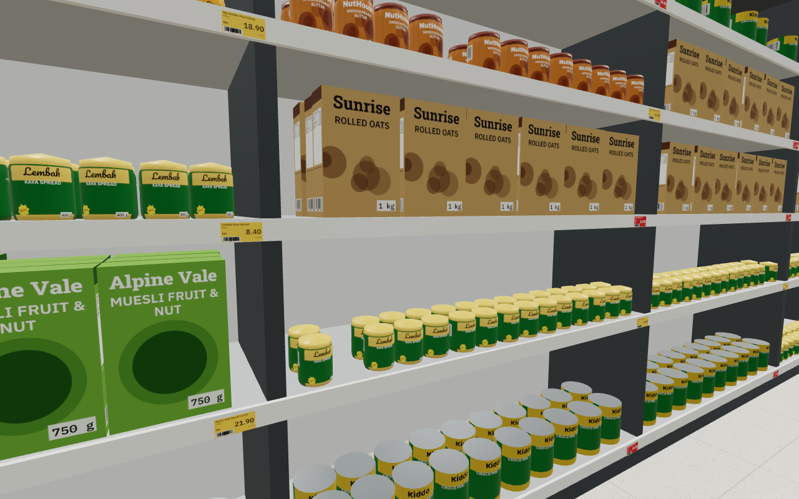

# AisleLens Store 3D

A first-person 3D supermarket you walk through at eye height, with products you can pick off the shelf, turn over, put back or drop in a basket. Every view can be saved as a RealSense-style RGB-D frame with exact product labels, so the same store doubles as a training and test set for the product-recognition model.



## Run it

Open `index.html` in a desktop browser (Chrome, Edge, Firefox, Safari). It needs internet once to load three.js and the fonts; nothing else is installed.

| Key | Action |
| --- | --- |
| W A S D, Shift | Walk, run (1.35 m/s walking, 2.4 m/s running) |
| Mouse | Look (click the view to capture the mouse, Esc to free it) |
| C | Crouch to see the bottom shelf |
| Click or E | Pick up the product under the ring; click again to put it back |
| Wheel or R | Turn the held product to read the back panel and barcode |
| B / right-click | Drop the held product in the basket (running total in RM) |
| P | Capture a training frame |
| V | Ask AisleLens: send this frame to the vision model (`python vision/serve.py`) and show its verdict, with the simulator's ground truth underneath |
| 1 / 2 / 3 / 4 | RGB, depth, label mask, RGB with depth inset |

Phones and tablets get a joystick on the left and drag-to-look on the right.

## What is in the store

- 4 aisles plus 2 wall runs of double-sided gondolas (14 m long, 5 shelves, 1.8 m aisles), open dairy chillers on the back wall, a produce section with fruit piles, and checkouts by the entrance.
- 54 fictional SKUs from fictional Malaysian-style brands across 8 categories, about 20,000 product instances. Boxes, cans, bottles, jars and fruit, with front panels, nutrition panels and **real, decodable EAN-13 barcodes** (in the GS1 `2` in-store range, so they never clash with real products).
- Shelf-edge price tags with RM prices, promo tags and barcodes.
- Realistic mess: random gaps, pulled-back facings, slightly rotated packs, stacked short items.
- **Re-stock shelves** shuffles the planogram; **Change lighting** randomises colour temperature and brightness (domain randomisation).

## Camera and frame output

Pick the camera in the panel. Capture size and field of view match the real sensors:

| Preset | Size | FOV (H × V) | Depth range used | Noise model |
| --- | --- | --- | --- | --- |
| RealSense D455 | 1280 × 800 | 91° × 65° | 0.52 to 8 m | σ = 0.005·z² m |
| RealSense D435 | 1280 × 720 | 69° × 42.5° | 0.28 to 6 m | σ = 0.01·z² m |
| Smart glasses | 1280 × 960 | 75° × 59° | 0.3 to 6 m | σ = 0.008·z² m |

Each capture writes, aligned pixel for pixel:

| File | Format |
| --- | --- |
| `rgb/NNNNN.png` | 8-bit colour |
| `depth/NNNNN.png` | 16-bit, millimetres, 0 = no data. Same convention as `rs2::depth_frame` with `depth_scale` 0.001, so the RealSense test code can read sim and real frames the same way |
| `mask/NNNNN.png` | R = class id (SKU) or 255 = price tag, G·256 + B = instance id (65535 = the held item, tag id for price tags) |
| `labels/NNNNN.json` | Camera intrinsics (fx, fy, cx, cy), camera pose, planogram id, and per visible object: `type` product or price_tag; SKU, brand, name, EAN-13, price, 2D box (x, y, w, h), visible pixels, mean depth; for products the world position and `held` (with `held_view`: front, back, side, angled or scan); for tags the printed price text and promo flag |
| `gallery/SKU/view.jpg` | With `--refs`: 8 clean reference photos per product (front, back, sides, high, low, three-quarter) for the embedding gallery |
| `catalog.json` | The class list |

The depth noise option adds RealSense-like artefacts: depth error growing with distance squared, missing pixels at object edges, and no data outside the sensor range. Turn it off for clean ground truth.

See [`sample/`](sample/) for one frame: `rgb.png`, `depth.png` (16-bit), `depth_preview.png` (colourised), `mask.png`, `labels.json`.

## Generate a dataset without clicking

```bash
cd prototypes/store-sim-3d
npm i playwright
node generate_dataset.mjs --frames 500 --camera d435 --out ./dataset --gpu
```

It uses the Chrome or Edge already installed on the machine, so `npm i playwright` is the only setup. Pass `--browser chromium` to use Playwright's own browser instead (run `npx playwright install chromium` first).

The script puts a virtual shopper at random positions and angles in front of the shelves (eye height 1.0 to 1.75 m, looking up and down), re-stocks every 50 frames, changes the lighting every frame, and writes the files above. In a share of frames (`--held-ratio`, default 0.35) the shopper holds a product in a simple hand, 0.3 to 0.7 m from the camera, showing the front, back, a side, a random angle, or the barcode close up ("scan"). `--jpg` writes RGB as JPEG and `--skip depth,mask` leaves those out, which keeps a 1,500-frame training set near 300 MB. Use a different `--seed` for train, validation and test so the test shelves are layouts the model never saw. With `--gpu` on a normal laptop it does a few frames per second. Without a GPU it falls back to software rendering at about one frame every 10 seconds.

In the browser, the **Save dataset .zip** button bundles the frames captured by hand. Browsers block downloads inside the hosted Claude viewer, so use it from a local copy of `index.html`.

## Scripting API

`window.sim` is available once the page has loaded:

```js
await sim.capture({ noise: true, format: 'jpg', skip: ['mask'] })   // { rgb, depth, mask (base64), labels }
sim.holdItem(seed, { sku, view })     // put a product in the shopper's hand
sim.dropHeld()
await sim.renderReference('AL-011', 'back', 320)  // clean catalogue photo (base64 JPEG); sim.refViews() lists views
sim.randomPose(seed, { minDist })     // jump to a random shelf-facing pose
sim.setPose({ x, z, yaw, pitch, eye })
sim.restock(seed)                     // new planogram
sim.randomLighting(seed)
sim.setPreset('d435' | 'd455' | 'glasses')
sim.catalog()
```

## Limits

- Products are simple shapes with generated artwork, not scanned 3D models. They are good for detector and pipeline testing, depth handling and price-tag reading; real product photos are still needed to train the exact-SKU embedding model (see `docs/vision-model-report.md`).
- Lighting is image-based plus a few directional lights, without shadows or reflections between objects.
- Depth noise is a statistical model of the RealSense, not a simulation of its stereo matcher.

All stores, brands, barcodes and prices are made up.
